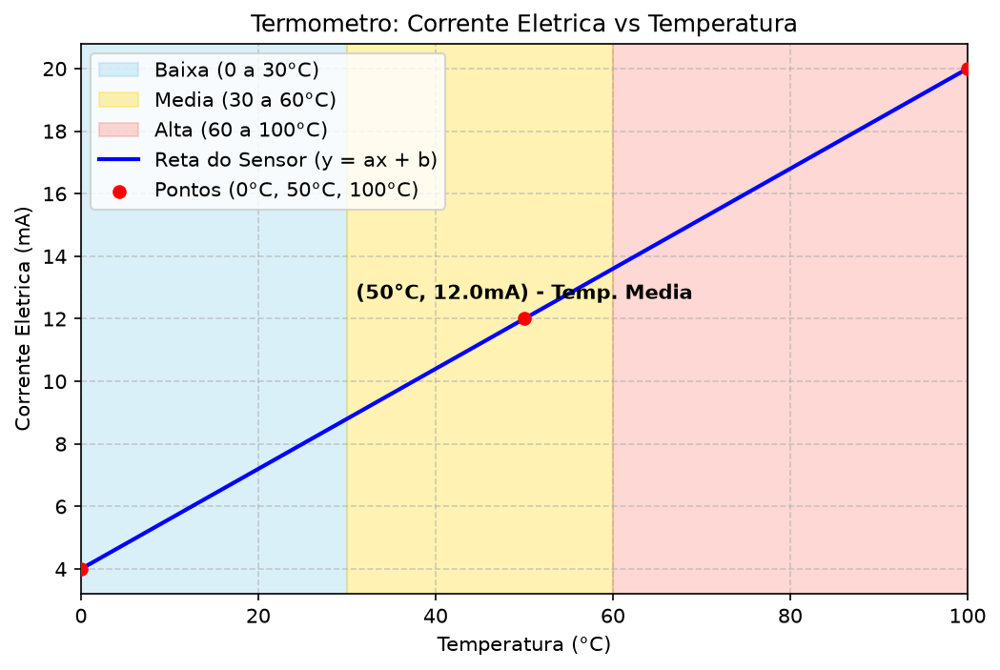
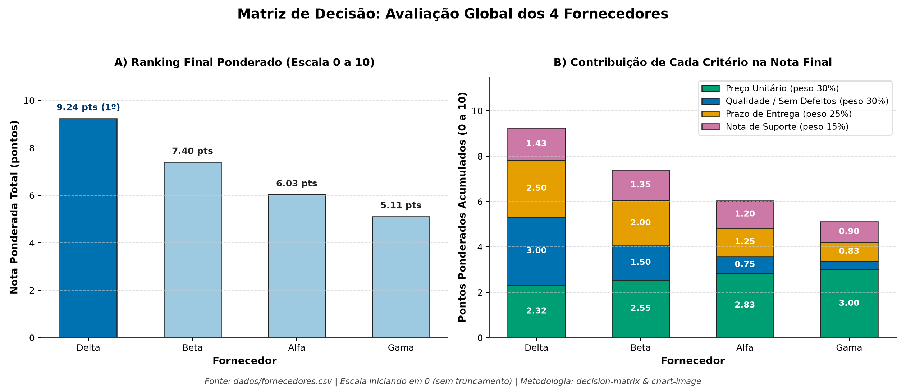
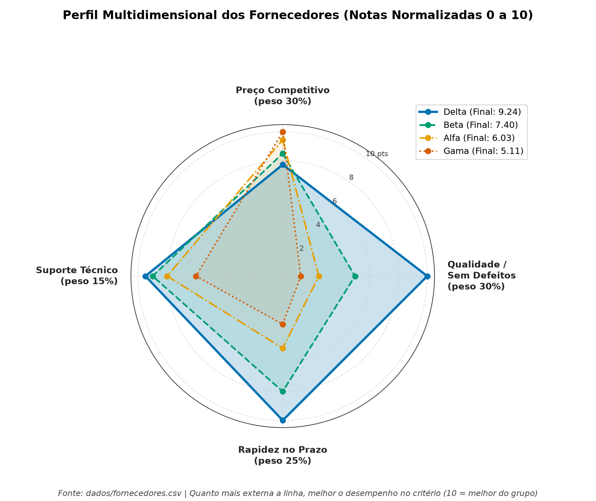
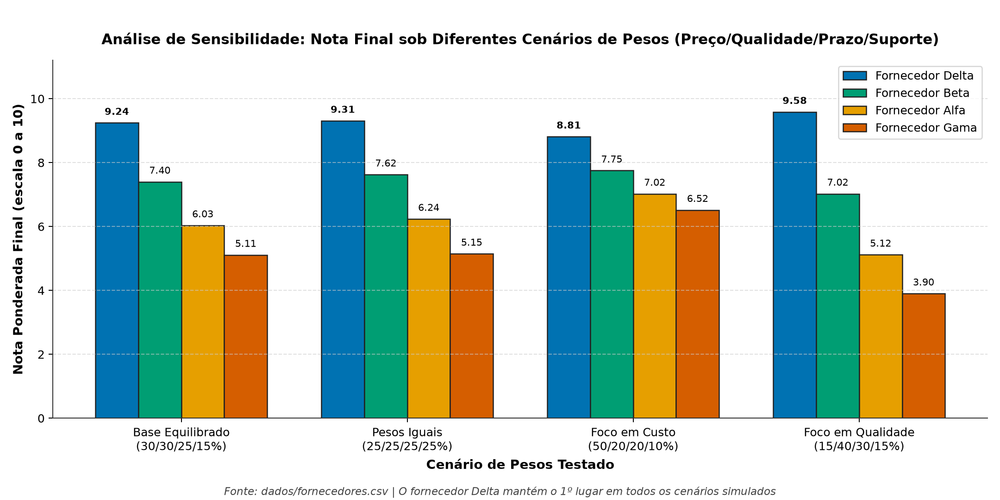

# Análise de Dados com Skills e Agentes (Aula Antigravity)

Repositório prático desenvolvido durante a aula de análise de dados e automação assistida por agentes, aplicando regras de projeto (`AGENTS.md`) e skills especializadas (`.agents/skills/`).

---

## 📁 Estrutura do Projeto

```text
├── .agents/skills/               # Skills utilizadas pelo agente
│   ├── chart-image/              # Criação de gráficos com qualidade de publicação e QA visual
│   ├── conferir-csv/             # Auditoria de estrutura e qualidade de bases CSV
│   └── decision-matrix/          # Matriz de decisão multicritério ponderada e sensibilidade
├── dados/                        # Dados de entrada originais (nunca alterados)
│   ├── fornecedores.csv          # Base limpa dos 4 fornecedores
│   └── fornecedores_erro.csv     # Base com falhas para auditoria e tratamento
├── resultados/                   # Todas as saídas geradas pelos scripts
│   ├── termometro/               # Gráfico do sensor de temperatura (4–20 mA)
│   ├── fornecedores/             # Relatórios, gráficos e CSV tratado dos fornecedores
│   ├── qualidade.md              # Relatório de qualidade e tratamento de dados
│   └── fornecedores_tratado.csv  # Base de fornecedores após imputação pela mediana
├── AGENTS.md                     # Combinados e regras de governança do projeto
├── termometro.py                 # Cálculo da equação da reta (y = ax + b) e faixas térmicas
├── fornecedores.py               # Matriz de decisão e geração de 4 gráficos analíticos
└── conferir_fornecedores_erro.py # Auditoria de qualidade do CSV e preenchimento de ausências
```

---

## 🛠️ Etapas Desenvolvidas

### 1. Calibração de Sensor / Termômetro (`termometro.py`)
- Calcula os coeficientes **A** (`0.16`) e **B** (`4.0`) da reta `y = ax + b` a partir dos pontos `(0°C, 4mA)` e `(100°C, 20mA)`.
- Calcula a corrente elétrica para `X = 50°C` (`Y = 12.0 mA`).
- Verifica limites operacionais (`0–100°C` e `4–20 mA`) e classifica a temperatura em **Baixa** (`≤ 30°C`), **Média** (`30–60°C`) e **Alta** (`> 60°C`).



---

### 2. Matriz de Decisão de Fornecedores (`fornecedores.py`)
Utilizando as skills **`decision-matrix`** e **`chart-image`** sobre `dados/fornecedores.csv`:
- **Critérios e Pesos:** Preço Unitário (`30%`), Qualidade / Baixo Índice de Defeitos (`30%`), Prazo de Entrega (`25%`) e Nota de Suporte (`15%`).
- **Vencedor:** **Delta** (`9.24 / 10`), mantendo o 1º lugar em todos os 4 cenários da análise de sensibilidade.
- **Relatório completo:** [`resultados/fornecedores/relatorio_fornecedores.md`](resultados/fornecedores/relatorio_fornecedores.md)



#### Perfil Multidimensional (Radar) e Análise de Sensibilidade



---

### 3. Auditoria e Tratamento de Dados (`conferir_fornecedores_erro.py`)
Utilizando a skill **`conferir-csv`** sobre `dados/fornecedores_erro.csv`:
- **Diagnóstico:** Identificados **2 valores ausentes** em 4 registros (`suporte_nota` ausente no fornecedor `Beta` e `preco_unitario` ausente no fornecedor `Delta`).
- **Tratamento (sem alterar o arquivo original):** Preenchimento pela **mediana** dos valores válidos de cada coluna (`suporte_nota = 8` para `Beta` e `preco_unitario = 90` para `Delta`), gerando [`resultados/fornecedores/fornecedores_tratado.csv`](resultados/fornecedores/fornecedores_tratado.csv) e documentando todo o processo em [`resultados/qualidade.md`](resultados/qualidade.md).

---

## ▶️ Como Executar o Projeto

1. Crie o ambiente virtual `.venv` e instale as dependências:
   ```powershell
   python -m venv .venv
   .\.venv\Scripts\python.exe -m pip install matplotlib numpy
   ```
2. Execute os scripts:
   ```powershell
   .\.venv\Scripts\python.exe termometro.py
   .\.venv\Scripts\python.exe fornecedores.py
   .\.venv\Scripts\python.exe conferir_fornecedores_erro.py
   ```

