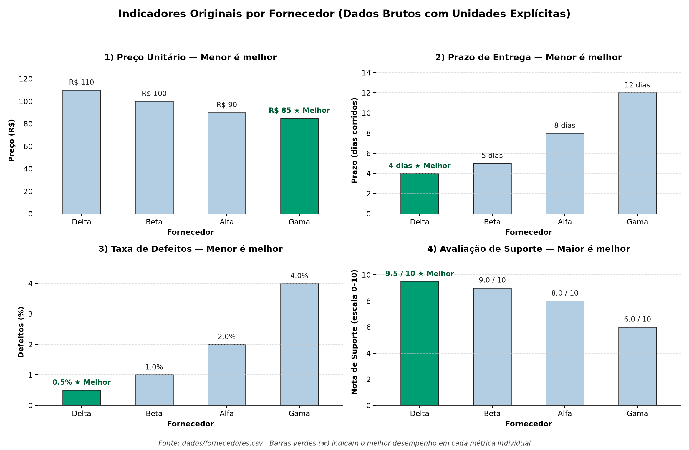

# Matriz de Decisão: Escolha do Melhor Fornecedor

## 1. Contexto da Decisão e Alternativas
- **Objetivo:** Selecionar o melhor fornecedor com base nos dados de `dados/fornecedores.csv` usando as skills `decision-matrix` e `chart-image`.
- **Alternativas avaliadas:** Alfa, Beta, Gama e Delta.

## 2. Dados Originais dos Fornecedores

| Fornecedor | Preço Unitário (R$) | Prazo (dias) | Defeitos (%) | Nota de Suporte (0-10) |
|---|---:|---:|---:|---:|
| Alfa | 90.00 | 8 | 2.0% | 8.0 |
| Beta | 100.00 | 5 | 1.0% | 9.0 |
| Gama | 85.00 | 12 | 4.0% | 6.0 |
| Delta | 110.00 | 4 | 0.5% | 9.5 |

### Comparação Visual dos Dados Originais

## 3. Critérios, Pesos e Normalização (Escala 1 a 10)
Seguindo a fórmula da skill `decision-matrix` para critérios objetivos:
- **Menor é melhor** (`Preço`, `Prazo`, `Defeitos`): `Nota = 10 × (Melhor Valor / Valor do Fornecedor)`
- **Maior é melhor** (`Suporte`): Valor já está na escala de 0 a 10.

**Pesos definidos (Total = 100%):**
- **Preço Unitário:** 30%
- **Qualidade (Baixo % de Defeitos):** 30%
- **Prazo de Entrega:** 25%
- **Suporte:** 15%

## 4. Resultado da Matriz de Decisão

| Posição | Fornecedor | Preço (30%) | Qualidade (30%) | Prazo (25%) | Suporte (15%) | **Nota Final Ponderada** |
|:---:|---|---:|---:|---:|---:|---:|
| 1º | **Delta** **(Vencedor)** | 7.73 (2.32) | 10.00 (3.00) | 10.00 (2.50) | 9.50 (1.43) | **9.24** |
| 2º | **Beta** | 8.50 (2.55) | 5.00 (1.50) | 8.00 (2.00) | 9.00 (1.35) | **7.40** |
| 3º | **Alfa** | 9.44 (2.83) | 2.50 (0.75) | 5.00 (1.25) | 8.00 (1.20) | **6.03** |
| 4º | **Gama** | 10.00 (3.00) | 1.25 (0.38) | 3.33 (0.83) | 6.00 (0.90) | **5.11** |

### Gráfico Principal: Ranking e Composição da Nota

### Perfil Multidimensional (Radar 0 a 10)

## 5. Análise de Sensibilidade (Outros Cenários de Pesos)

| Cenário | 1º Lugar | 2º Lugar | 3º Lugar | 4º Lugar |
|---|---|---|---|---|
| Base Equilibrado (30/30/25/15%) | **Delta** (9.24) | Beta (7.40) | Alfa (6.03) | Gama (5.11) |
| Pesos Iguais (25/25/25/25%) | **Delta** (9.31) | Beta (7.62) | Alfa (6.24) | Gama (5.15) |
| Foco em Custo (50/20/20/10%) | **Delta** (8.81) | Beta (7.75) | Alfa (7.02) | Gama (6.52) |
| Foco em Qualidade (15/40/30/15%) | **Delta** (9.58) | Beta (7.02) | Alfa (5.12) | Gama (3.90) |

### Gráfico da Análise de Sensibilidade

## 6. Recomendação Final e Trade-offs
- **Fornecedor Recomendado:** **Delta** (Nota Final: **9.24** de 10).
- **Vantagem sobre o 2º colocado (Beta):** +1.84 pontos (+24.9%).
- **Principais Pontos Fortes e Trade-offs:**
  - **Delta:** Possui o menor prazo (4 dias), a menor taxa de defeitos (0.5%) e o melhor suporte (9.5), compensando com folga o preço unitário mais alto (R$ 110).
  - **Beta:** Segundo colocado equilibrado, com bom prazo (5 dias), poucos defeitos (1%) e ótimo suporte (9.0).
  - **Alfa e Gama:** Têm preços menores (R$ 90 e R$ 85), mas perdem muitos pontos pelo prazo de entrega maior (8 e 12 dias) e pela taxa de defeitos até 8 vezes maior que a do Delta.
